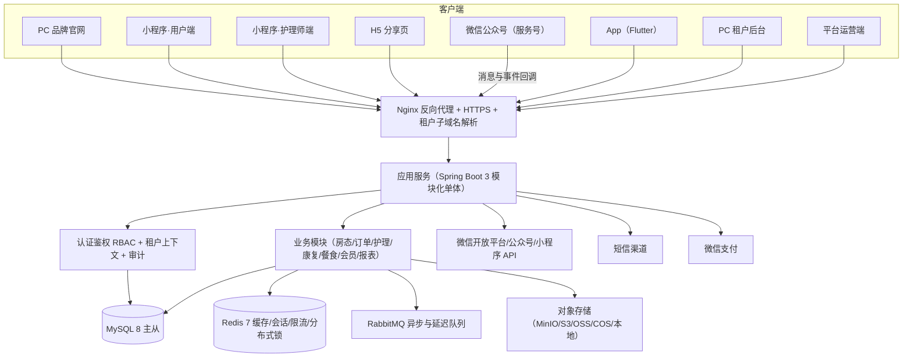
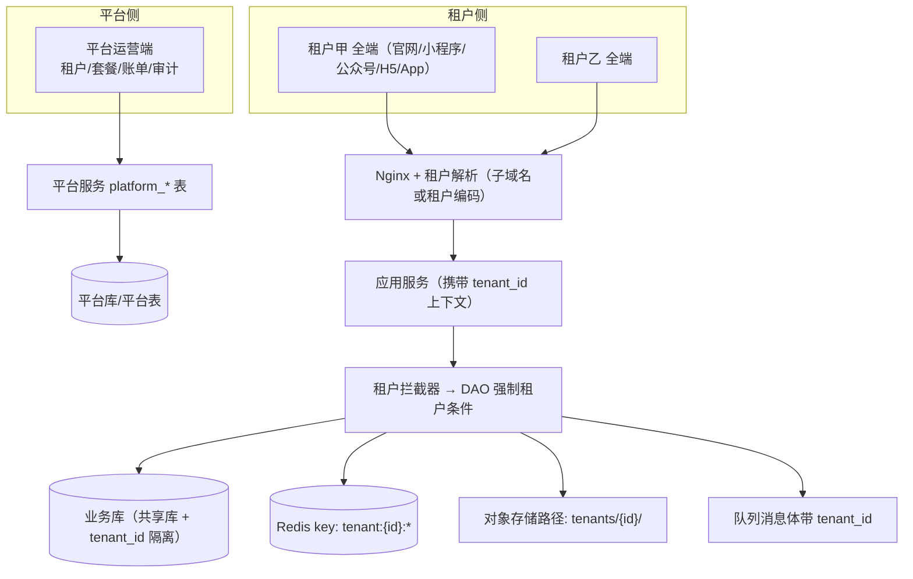

# 月子中心 数字化多端平台 PRD

> 品牌背景：城市核心商圈的连锁月子中心（母婴照护服务机构），自有品牌，一家总部旗舰店 + 两家区域门店，单店可容纳 20~35 组母婴家庭。业务范围：28 天/42 天标准月子套餐与定制套餐、房型分档（温馨单间/豪华套间/尊享套房）、母婴护理（一对一专护/一对多轮值护理）、产后康复（盆底肌评估与修复、腹直肌修复、中医调理、产后瑜伽、满月发汗）、营养月子餐（三餐三点、忌口与过敏原管理）、新生儿照护（喂养记录、黄疸监测、抚触与游泳）、居家月嫂上门服务、母婴用品零售（待产包、月子服、护理耗材）。
> 项目名称：月子中心数字化多端运营平台（多租户 SaaS 版）
> 产品矩阵：平台运营端（SaaS 控制台） + PC 租户后台 + PC 品牌官网（中英双语 SEO） + 微信服务号 + 微信小程序·用户端 + 移动端 H5 分享页 + 微信小程序·护理师端 + Flutter 独立 App（iOS/Android）
> 上线模式：一次性完整上线，不分一期二期
> 存储方案：抽象对象存储驱动层，支持多存储后端，后台可视化切换。可选驱动：本地磁盘 / AWS S3 / 阿里云 OSS / 腾讯云 COS / MinIO。后台选择存储类型，填写对应参数，连接测试通过后保存实时生效，无需修改代码。房间实景图、套餐图、护理记录照片、合同附件、资质文件全部存入选中存储，路径统一按租户前缀隔离。
> 架构说明：采用前后端分离架构，对标【中医馆数字化平台（公众号 + 小程序 + PC 官网 + 后台管理）】体系，并升级为多租户 SaaS。保留：RBAC 多角色权限体系、全操作审计日志、公众号/小程序/H5/App UnionID 统一会员互通、多驱动对象存储、多语言 i18n、菜单可视化编辑、系统参数可视化配置、富文本编辑器 CMS、消息配置、SSO 单点登录。剔除医疗诊疗、挂号、处方类模块。
> 数据字典口径：**本平台所有状态、角色、类型、渠道、房态等字典项一律使用中文名称，禁止在页面、接口返回、报表与文档中使用英文编码值**；确需编码的内部字段仅在数据库层保留，前端展示与导出统一取字典中文名称。

## 一、核心约束（母婴行业合规与业务红线，代码强制约束）

1. **资质先行**：租户开通前必须上传并留存《营业执照》《母婴保健技术服务执业许可证》（或按地方要求取得的相应许可）、《食品经营许可证》（自营月子餐必备）、《公共场所卫生许可证》、消防验收/备案材料；护理岗人员须上传育婴员/护士/母婴护理相关资质并在租户后台建档。
2. **服务与医疗边界**：平台只做照护服务记录与流程管理，**不做诊断、不开处方、不做治疗建议**；新生儿或产妇体征超出预警阈值时，系统只提示"建议及时就医"并记录上报，不得输出医疗结论。对外文案禁止宣称疾病治疗、疗效承诺。
3. **广告与宣传合规**：套餐页、官网、公众号图文中的功效描述须经内容运营审核后发布；禁止使用"最""第一""包治""保证恢复"等绝对化或疗效性表述；敏感词库命中即拦截并提示修改。
4. **定金、尾款与预付款**：定金比例、尾款支付节点（入住前/出馆前）、押金金额、退订违约金比例全部后台可配，不写死；涉及储值/预付卡业务时，页面必须展示预付卡使用规则与退款规则，并按当地单用途商业预付卡管理要求提示备案。
5. **敏感个人信息**：孕周、分娩方式、母婴健康数据、身份证号、手机号、家庭住址属敏感个人信息。全链路 HTTPS 传输、数据库字段加密存储、列表与导出脱敏（手机号中间四位掩码、身份证仅保留首尾）、客户首次提交前单独弹窗取得同意，同意记录留痕可追溯。
6. **多语言**：平台内置简体中文 + English 双语，后台可启用/停用更多语言；内容类字段按语言独立录入，前台按用户选择渲染。
7. **菜单全可视化**：公众号自定义菜单、PC 官网顶部导航、小程序 tabBar、H5 底部导航、PC 后台侧边导航，全部后台拖拽编辑，保存实时生效，无需发版。
8. **多租户强制**：本平台为多租户 SaaS，平台运营端与租户后台为两套独立后台、两套角色、两套登录入口；所有租户业务表带 `tenant_id` 并建复合索引，跨租户访问一律拒绝并写安全审计。
9. **端间一致**：全部端共用一套后端 API、一套权限模型、一套会员 UnionID、一套对象存储；不允许多端各建后端。
10. **数据留存**：护理记录、订单、退款、审计日志按监管与纠纷处理需要长期留存（审计日志 ≥180 天，订单与护理记录 ≥3 年），删除操作仅做逻辑删除并留痕。

## 二、架构设计（深度档：多端 ≥4 且含多租户 SaaS）

### 2.1 需求摘要

#### 2.1.1 功能需求（按端）

| 端 | 核心功能 | 依赖模块 |
|---|---|---|
| 平台运营端 | 租户管理、套餐与配额、账单与计费、平台公告、平台审计、平台账号与角色、租户初始化模板 | 多租户底盘、RBAC、审计 |
| PC 租户后台 | 房态档期、套餐商品、线索 CRM、订单签约、入馆与出馆、护理服务、产后康复、月子餐、排班、会员营销、内容 CMS、报表、系统配置、公众号管理 | 全部业务模块 + 系统配置 5 模块 |
| PC 品牌官网 | 品牌展示、房型与套餐、康复项目、月子餐、护理团队、真实案例、门店分布、资讯、在线预约参观、SEO（中英） | CMS、i18n、线索 |
| 微信公众号（服务号） | 11 项运营子页、菜单、自动回复、模板消息、粉丝与标签、素材与图文 | 公众号管理、消息配置 |
| 小程序·用户端 | 授权登录、房型套餐浏览、预约参观、定金下单、订单与合同、入住须知、护理日志查看、康复预约、商城、会员中心 | UnionID、支付、护理服务 |
| H5 分享页 | 套餐与房型分享落地、活动页、支付回跳、表单留资 | UnionID、CMS |
| 小程序·护理师端 | 排班查看、房态与负责母婴、护理计划执行与打卡、护理记录、交接班、异常上报、月子餐核对 | 护理服务、排班、消息 |
| App（Flutter） | 会员端完整能力 + 推送、离线缓存、护理日志与康复提醒 | UnionID、推送 |

#### 2.1.2 非功能需求（NFR，量化阈值）

| 维度 | 指标 |
|---|---|
| 并发 | 峰值 300 QPS（浏览与查询为主），下单/签约接口峰值 20 QPS |
| 响应 | 后台列表首屏 ≤2 秒；接口 P95 ≤500 毫秒；护理师端打卡提交 ≤1 秒反馈 |
| 可用性 | 99.5%（单机房 Docker Compose 部署，明确存在单点风险，靠备份与快速恢复兜底） |
| 数据量 | 3 年：单租户会员 ≤5 万、订单 ≤3 万、护理记录 ≤200 万条、图片与视频 ≤50 GB |
| 安全 | 全站 HTTPS；密钥 AES 加密存储；敏感字段加密与脱敏；审计日志留存 ≥180 天 |
| 合规 | ICP 备案、食品经营许可、卫生许可、隐私政策与单独同意、预付卡规则公示 |
| 可维护 | 金额、比例、天数、开关类参数 100% 后台可配，不允许写死在代码或前端 |

### 2.2 架构图

#### 2.2.1 一后端多前端壳

#### 2.2.2 多租户两条请求链路

### 2.3 核心数据流

- **正常链路（线上预约到出馆结算）**：小程序选房型套餐 → 提交参观预约（留资入线索池）→ 销售顾问跟进并转订单 → 微信支付定金（写入支付流水、锁定档期房态）→ 入住前提交健康告知与证件（脱敏存储）→ 到馆登记分配房间（房态转为"已入住"）→ 护理师端按护理计划执行并记录 → 出馆前结算尾款与押金退还 → 出馆（房态转为"待清洁"→"可预订"）→ 42 天回访任务自动生成。
- **异常链路（支付回调或护理异常）**：支付回调验签失败或超时 → 订单保持"待支付"并进入主动查单队列（每 5 分钟一次，最多 6 次）→ 仍失败则标记"支付异常"并推送财务待办 → 人工核对银行流水后手动确认或关闭订单并释放档期；护理记录中出现超出预警阈值的体征 → 护理师端上报 → 护理主管端即时提醒并生成异常处理单 → 处置记录留痕 → 必要时提示家属就医，系统不做医疗判断。

### 2.4 ADR 架构决策记录

#### ADR-001：采用模块化单体，而非微服务拆分

- **状态**：已接受
- **背景**：单租户日均订单量在数十单量级，多端共用业务逻辑，团队规模 6~8 人，运维只有一套 Docker Compose 环境。
- **决策**：后端采用 Spring Boot 3 模块化单体，按业务域分 Maven 模块（房态、订单、护理、康复、餐食、会员、内容、系统、平台），模块间只通过接口与领域事件交互。
- **备选与取舍**：
  - A 微服务 + 注册中心 — 优点：独立扩缩容；缺点：运维与联调成本高、跨服务事务复杂；不选，因业务量不足且无独立扩缩容需求。
  - B 单体不分模块 — 优点：最快；缺点：护理、订单、平台端耦合，后续拆分成本高；不选，因多租户与平台端必须边界清晰。
- **后果**：部署简单、事务一致；后续若单模块压力突出，可将该模块独立为服务，模块边界已预留。

#### ADR-002：多租户数据隔离采用共享库 + tenant_id

- **状态**：已接受
- **背景**：目标客户为区域连锁与单店月子中心，单租户数据量中等；平台需要跨租户统计开通率与用量。
- **决策**：单库共享表 + 全表 `tenant_id`，DAO 层统一拦截器注入租户条件，关键表建 `(tenant_id, 业务键)` 复合索引与唯一约束。
- **备选与取舍**：
  - A 独立 schema — 隔离更强；缺点：连接池与 DDL 版本管理复杂，运维成本高；当前租户量不足 50，不选。
  - B 独立库/独立实例 — 隔离最强；缺点：成本高、跨租户报表需汇总；仅对大客户单独立项。
- **后果**：成本与运维最优；风险在于漏加租户条件，需靠拦截器、代码扫描与越权回归用例三重保障；升级阈值写入扩展规划。

#### ADR-003：平台运营端与租户后台物理分离

- **状态**：已接受
- **背景**：平台方需要管理租户、套餐与账单，但不得查看租户业务明细；租户管理员不得进入平台端。
- **决策**：两套路由前缀（平台端 /platform，租户端 /tenant）、两套菜单树、两套角色体系、两个登录入口；用户表以"用户类型"字段区分平台账号与租户账号。
- **备选与取舍**：
  - A 单一后台按角色切换租户 — 优点：开发省事；缺点：权限边界模糊、越权风险高、审计难分离；不选。
- **后果**：前端需要维护两套壳，但越权面收敛；验收必须覆盖"互相进不去"。

#### ADR-004：两个小程序共用一套组件层与请求层

- **状态**：已接受
- **背景**：用户端与护理师端同为微信原生小程序，业务实体（订单、护理计划、房态）高度重叠。
- **决策**：同仓库多小程序工程（`miniprogram-user`、`miniprogram-nurse`），共用 `components/`、`request/`、`utils/`、`constants/`（字典中文名常量），各端只保留页面与差异化样式。
- **备选与取舍**：
  - A 改用 uni-app 统一多端 — 优点：一套代码多端构建；缺点：原生能力（订阅消息、扫码、蓝牙）适配成本与调优风险；不选，因只需两个微信小程序。
  - B 两端各写一套 — 优点：互不影响；缺点：字典与请求层重复、BUG 双改；不选。
- **后果**：字典与接口改动一次生效；发布需按端分别提审，需在任务清单中区分。

#### ADR-005：RabbitMQ 承担异步通知与延迟任务

- **状态**：已接受
- **背景**：入住提醒、尾款催缴、42 天回访、护理异常通知、公众号模板消息推送均有时序要求，且不能阻塞下单与记录主链路。
- **决策**：引入 RabbitMQ，使用延迟队列（按毫秒级 TTL + 死信转发）承载定时提醒，业务消息体统一携带 `tenant_id`，消费失败进入重试队列（3 次后入死信并告警）。
- **备选与取舍**：
  - A 仅用数据库轮询定时任务 — 优点：无额外组件；缺点：精度差、大表扫描压力；不选，因提醒类需求密集。
  - B Kafka — 优点：高吞吐；缺点：延迟队列实现复杂、运维重；当前量级不需要，不选。
- **后果**：需要新增队列监控与死信告警；定时任务改为按租户分片投递。

### 2.5 技术选型对比

| 维度 | 方案甲 | 方案乙 | 方案丙 | 结论与理由 |
|---|---|---|---|---|
| 后端语言与框架 | Java 17 + Spring Boot 3 + MyBatis-Plus | PHP + Laravel | Python + FastAPI | 选 Java：多租户拦截器、事务与复杂报表更稳，团队已有 Java 积累，长期演进成本低 |
| 数据库 | MySQL 8（utf8mb4，主从） | PostgreSQL | SQLite | 选 MySQL 8：生态成熟、运维熟悉、主从与备份方案现成；复杂查询需求可由索引与汇总表解决 |
| 后台前端 | Vue3 + Vite + TypeScript + Element Plus | React + Ant Design | 传统 jQuery 模板 | 选 Vue3：vue-pure-admin 模板可直接复用菜单、权限、多页签，交付速度最快 |
| 小程序方案 | 微信原生（双工程共用组件层） | uni-app | Taro | 选原生：两端均为微信小程序，原生订阅消息与扫码能力最稳；多端需求仅两枚小程序，无需跨端框架 |
| 部署 | Docker Compose | Kubernetes | 宝塔面板 | 选 Docker Compose：单机房多容器，交付即起；K8s 对当前体量属过度设计 |

### 2.6 风险与缓解（架构层）

| 风险 | 影响 | 概率 | 缓解措施 |
|---|---|---|---|
| 跨租户越权（漏加租户条件） | 数据串号、合规事故 | 中 | 拦截器强制注入 + 手写 SQL 走代码扫描规则 + 越权用例进回归 |
| 微信接口权限依赖认证状态 | 模板消息、网页授权不可用 | 高 | 上线前确认服务号已认证、IP 白名单、模板已申请；未就绪时通道降级为短信或站内信 |
| 支付回调重复或丢失 | 重复锁房或漏单 | 中 | 回调幂等键 + 主动查单 + 每日对账任务 |
| 母婴健康数据泄露 | 法律责任与口碑损失 | 中 | 字段加密、脱敏展示、最小必要授权、导出留痕与审批 |
| 单机房单点故障 | 全端不可用 | 中 | 每日备份 + 备份恢复演练 + 监控告警 + 30 分钟恢复预案 |
| 多端登录与会员不一致 | 重复建档、订单错乱 | 中 | 统一 UnionID + 单后端 + 手机号二次绑定校验 |
| 公众号同一账号被现网系统接管 | 回调互踢、菜单互盖 | 中 | 接号前完成占用检查，切换走四步窗口，禁止双系统并行 |
| 护理记录事后补录导致失真 | 纠纷时证据不足 | 中 | 记录带提交时间与服务端时间双戳，补录须填原因并留痕 |

### 2.7 扩展规划（阈值明确）

- **端增长**：新增端只增加前端壳与角色权限，不改后端接口；每端必须在端矩阵登记并在验收清单单独成段。
- **租户增长**：租户数 > 50、或单租户业务数据 > 500 万行、或单库 > 200 GB → 评估切换独立 schema；单租户要求独立实例 → 直接独立库。迁移须写租户冻结窗口、双写校验与回滚步骤。
- **并发增长**：先加 Redis 缓存与读写分离 → 再用 RabbitMQ 削峰 → 最后才考虑分库分表。
- **分库分表触发阈值**：单表 > 500 万行（护理记录、消息流水）或单库 > 200 GB，按 `tenant_id` 做分片键。
- **当前不做**：微服务拆分、Kubernetes、分库分表、独立 App 之外的第二套原生端。

## 三、多租户设计

### 3.1 租户域模型（平台级表统一 platform_ 前缀）

| 表 | 关键字段 |
|---|---|
| 平台租户表 | 租户标识、租户编码（唯一）、租户名称、所属行业、联系人、联系电话、套餐标识、租户状态、试用到期时间、正式到期时间、席位数上限、公众号数上限、存储配额（GB）、短信配额（条）、接口配额、创建时间 |
| 平台套餐表 | 套餐标识、套餐名称、价格、计费周期、含端数量、席位额度、公众号额度、存储额度、短信额度、接口额度、是否支持试用 |
| 平台租户用量表 | 租户标识、已用席位、已用公众号、已用存储、已用短信、已用接口调用、统计日期 |
| 平台账单表 | 账单标识、租户标识、账期、计费项、数量、金额、账单状态（待支付/已支付/已逾期）、支付时间 |
| 平台审计表 | 操作人、所属平台角色、动作、目标租户、结果、时间、来源 IP |
| 平台租户管理员表 | 租户标识、账号标识、是否主管理员 |

### 3.2 平台运营端页面清单

| 页面 | 关键字段与动作 |
|---|---|
| 租户管理 | 列表：租户编码、名称、行业、套餐、状态、到期时间、已用席位、公众号数量；支持按状态与到期时间筛选；开通、停用、恢复、续期、删除（二次确认并提示数据归档） |
| 租户开通向导 | 基本信息 → 选择套餐 → 配额确认 → 初始化（默认角色/菜单/参数/存储目录）→ 生成主管理员账号（密码一次性展示或邀请链接） |
| 套餐与配额 | 套餐增删改（价格/周期/五类额度）；单租户配额调整（加量需填原因并留痕）；超限策略（拦截写操作 / 转只读） |
| 账单与计费 | 账单列表（账期、金额、状态）、按席位用量生成账单、标记已支付、导出 |
| 平台公告 | 公告增删改、按租户或套餐定向推送、已读统计 |
| 平台审计 | 平台操作日志、登录日志、异常登录提醒；可按租户筛选 |
| 平台账号与角色 | 平台超级管理员、平台运营、平台财务三类角色；菜单与租户端完全隔离 |
| 平台看板 | 租户总数、活跃租户、试用转化率、到期预警、收入趋势 |

### 3.3 隔离落地四条铁律

1. 所有租户业务表必须含 `tenant_id`（非空），并建 `(tenant_id, 创建时间)`、`(tenant_id, 状态)` 复合索引；唯一约束必须带租户维度。
2. DAO 与拦截器强制注入租户条件，手写 SQL 也必须显式带；禁止 `WHERE id = ?` 这类裸主键查询；跨租户访问返回 403 并写安全审计。
3. 缓存 key 统一 `tenant:{租户标识}:业务键`，对象存储路径统一 `tenants/{租户标识}/...`，导出与删除严格限定当前租户边界。
4. 定时任务与队列消费按租户分片遍历，单租户失败不影响其他租户；任务日志带租户标识。

### 3.4 配额与计费

- 五类配额：席位数、公众号数、存储容量（GB）、短信条数、接口调用量。
- 计费维度：**按账号数（席位数）计费**（本期确认的唯一计费维度），账单按"套餐定额 + 超出席位按量补差"生成；存储与短信作为套餐内额度提示，暂不计费。
- 校验位置：席位与公众号数在服务层校验，接口调用量在网关校验，存储用量按对象存储目录统计并每日汇总；超限返回明确提示与升级引导，禁止静默放行。
- 欠费策略三级递进：页面横幅提示 → 限制新增写操作 → 停服，均可在平台端配置。

### 3.5 租户生命周期状态机

| 状态（字典中文名） | 进入条件 | 系统行为 |
|---|---|---|
| 试用中 | 平台开通试用 | 全功能可用，页面顶部显示剩余天数；到期自动转"已到期" |
| 正常 | 已付费且在有效期内 | 全功能可用 |
| 欠费 | 账单逾期未支付 | 可登录，写操作按配置限制，横幅提示缴费 |
| 停用 | 平台手动停用或严重欠费 | 拒绝登录、接口返回 403，数据保留且可只读导出；公众号回调只落库不执行业务 |
| 已到期 | 试用或服务到期 | 同停用；数据保留 90 天后归档 |

## 四、端矩阵表（本次全量生成）

| 端 | 承载角色 | 平台形态 | 登录方式 | 是否本次生成 | 说明 |
|---|---|---|---|---|---|
| 平台运营端 | 平台超级管理员、平台运营、平台财务 | Web 独立后台 | 平台账号 + 密码（可选 SSO） | 是（强制生成） | 与租户后台路由与权限彻底隔离 |
| PC 租户后台 | 租户管理员、店长、销售顾问、护理主管、营养师、财务、客服专员、内容运营 | Web（Vue3 + Element Plus） | 租户账号 + 密码（可选 SSO） | 是 | 全表按 `tenant_id` 隔离 |
| PC 品牌官网 | 访客、会员 | Web（响应式，中英） | 无需登录（预约留资）/ 会员登录 | 是 | SEO 与内容 CMS 驱动 |
| 微信公众号（服务号） | 会员、粉丝 | 服务号（菜单 + 模板消息 + 客服） | 微信授权（UnionID） | 是 | 11 项运营子页全量 |
| 小程序·用户端 | 会员、意向客户及其家属 | 微信小程序（原生） | 微信授权登录（UnionID） | 是 | 核心交易与护理日志查看入口 |
| H5 分享页 | 访客、会员 | H5（微信内 + 浏览器） | 免登录浏览 / 微信授权 | 是 | 分享落地与活动页 |
| 小程序·护理师端 | 护理师、月嫂、育婴师、护士 | 微信小程序（原生） | 员工账号登录（租户内角色） | 是 | 业务一线作业端，独立工程共用组件层 |
| App（Flutter） | 会员 | iOS + Android | 手机号 + UnionID 绑定 | 是 | 推送、离线缓存、护理提醒 |
| 供应商端 | 母婴用品供应商 | 独立小程序 | — | 否 | 本期不生成，PRD 保留后续扩展位 |
| 渠道商端 | 转介绍渠道、异业合作方 | 独立小程序 | — | 否 | 本期不生成，PRD 保留后续扩展位 |

**端间复用说明**：一个后端 + 多前端壳；共用 API、共用权限模型、共用 UnionID 会员、共用对象存储与消息通道；各端差异仅在界面形态、可见菜单与角色权限。小程序两端共用组件层与请求层，字典常量统一维护。

**租户边界**：平台运营端只能看到租户汇总与状态（席位用量、到期时间、账单），看不到任何租户的订单、会员、护理记录明细；租户后台与全部租户端共享同一 `tenant_id` 数据面。

## 五、技术栈配置表

| 层级 | 选型 | 版本与关键配置 |
|---|---|---|
| 后端语言 | Java | JDK 17（LTS），统一 UTF-8 |
| 后端框架 | Spring Boot + MyBatis-Plus | Spring Boot 3.2.x；MyBatis-Plus 3.5.x；Spring Security + JWT 鉴权；模块化多 Maven 工程 |
| 数据库 | MySQL | 8.0.x；字符集 utf8mb4、排序规则 utf8mb4_0900_ai_ci；连接地址与端口、库名、账号密码写入配置中心；连接池 HikariCP 最大 50、最小空闲 10、连接超时 30 秒；主从读写分离（写主库、报表读从库）；每日全量备份 + binlog 增量，保留 30 份 |
| 缓存与消息 | Redis / RabbitMQ | Redis 7.x：地址、端口、密码、库号 0（业务）与 1（会话）、最大连接 200、淘汰策略 allkeys-lru；RabbitMQ 3.12.x：地址、端口 5672、虚拟主机 /yuezizhongxin、账号密码、消息持久化、死信队列与重试队列各 1 组 |
| 后台前端 | Vue3 + Vite + TypeScript + Element Plus | 基于 vue-pure-admin 模板二次开发；Node 20；主色与 8px 栅格统一；禁止手写 layout |
| 小程序 | 微信原生 | 两套工程共用组件层；基础库 3.x；订阅消息模板按租户绑定 |
| 独立 App | Flutter | Flutter 3.x 稳定版；Riverpod 状态管理；Dio + 拦截器；Hive 本地缓存；极光推送 + 厂商通道；iOS 与 Android 双端 |
| 富文本 | WangEditor 5 | 图片粘贴即上传对象存储，多语言 tab |
| 对象存储 | MinIO（可切 5 驱动） | 本地磁盘 / AWS S3 / 阿里云 OSS / 腾讯云 COS / MinIO；Endpoint、Region、AccessKey、SecretKey、Bucket、外网域名；密钥加密存储；连接测试通过方可保存 |
| 反向代理 | Nginx | HTTPS（证书统一由运维下发）、租户子域名解析、静态资源缓存、上传体积限制 20 MB |
| 部署 | Docker Compose | 服务清单：nginx、app（后端）、mysql、redis、rabbitmq、minio、backup（定时备份）、monitor（可选） |
| 运维监控 | 日志 + 告警 | 应用日志按天滚动保留 30 天；接口错误率、队列积压、磁盘与备份结果告警到运维群 |
| 集成对接 | 微信生态 / 支付 / 短信 | 微信开放平台 UnionID、公众号与小程序接口、微信支付 v3；短信 6 渠道单选启用 |
| 多语言 | i18n | 默认简体中文 + English；语言包与内容字段双轨 |

## 六、需求校验补充

1. **系统全局参数可视化配置**：站点名称、Logo、ICP 备案号、客服电话、营业时间、门店地址、SEO 默认关键词、公众号与小程序凭证入口、微信支付参数、对象存储驱动、多语言开关、定金比例、尾款节点、押金金额、退订违约金比例、护理配比上限、护理记录预警阈值，全部后台表单配置，保存实时生效，无需改代码与重新打包；密钥类字段加密存储，页面只显示掩码。
2. **多语言 i18n 后台管理**：语言列表新增/停用/排序；前台语言切换器按启用语言渲染；套餐、房型、文章、案例、康复项目、页面文案均按语言独立字段；富文本编辑器内置语言 tab，未录入语言标记"未翻译"。
3. **菜单可视化编辑器（唯一出处）**：入口"系统配置 → 菜单可视化"，路由 `/tenant/system/menu-visual`；端选择（公众号/PC 官网/PC 后台导航/小程序 tabBar/H5 底部导航）+ PC/手机外壳切换；三栏布局（左菜单树、中属性面板、右实时预览）；属性含标题、图标、类型（站内页/外链/小程序页/关键词回复）、路径、排序、可见；支持同级拖拽与跨级移动，整树一次性保存，保存即时生效；未保存离开弹确认；公众号端额外"预览到微信"，发布动作在"公众号管理 → 菜单管理"执行；层级限制：公众号一级 ≤3、二级 ≤5，小程序 tabBar 2~5 项，H5 底部导航 ≤5 项。
4. **富文本编辑器 CMS**：套餐介绍、房型详情、康复项目、护理团队、品牌故事、资讯文章、图文草稿统一使用 WangEditor 5，禁止 textarea；工具栏含标题层级、加粗、颜色、对齐、列表、引用、图片、视频、表格、链接、源码、全屏；粘贴即上传；多语言 tab。
5. **RBAC 多角色与审计日志**：平台侧三角色与租户侧九角色分离；权限到菜单与按钮；除"审计日志"只读外，租户管理员对全部业务模块具备完整增删改查；审计日志记录登录、配置变更、订单与退款、护理记录修改、导出、菜单发布、凭证修改等，可按租户、操作人、时间、模块筛选并导出，日志本身不可新增/编辑/删除。
6. **UnionID 会员互通**：公众号、小程序用户端、H5、App 共用 UnionID；同一手机号跨端自动归并，冲突时进入人工确认队列，禁止静默覆盖。
7. **多驱动对象存储**：5 驱动可切；密钥加密；连接测试；切换驱动二次确认（历史文件仍由原驱动读取，新上传走新驱动）。
8. **接口防护**：预约参观、下单、支付、护理记录提交接口做防重复提交（幂等键）与限流（单用户 1 分钟 5 次）；评论与文章内容做敏感词校验。
9. **备份与合规弹窗**：数据库每日定时备份并留恢复记录；全端首次使用弹出用户协议与隐私政策，敏感信息采集前单独同意。
10. **后台 UI/UX 规范**：见第九章，开发必须照做。
11. **消息配置**：4 通道（公众号模板消息、小程序订阅消息、App 推送、站内信）+ 6 短信渠道单选启用 + 模板表（触发节点/通道/模板编号/字段映射）；模板编号按租户绑定；未启用短信渠道时验证码只写服务端日志并页面提示。
12. **SSO 配置**：支持 CAS / OAuth2 / OIDC / Sa-Token 四种协议；只填服务器根地址自动拼路径；Secret 加密掩码；账号映射未命中即拒绝登录；SSO 故障可降级为账号密码登录。
13. **房态档期联动**：房间档期按天为粒度，支持"可预订/已锁定/已入住/待清洁/维修中"五种中文房态；下单支付成功即锁定对应档期，取消或退订按规则释放；同一房间同一日期不得重复占用（数据库唯一约束校验）。
14. **护理记录可信**：每条护理记录带服务端时间戳与提交人，补录须填写补录原因；护理记录修改只允许在 24 小时内且留痕，超时须护理主管审批。
15. **数据导出管控**：导出会员与护理数据需填写用途，导出文件加水印与操作留痕，单次导出上限 5000 行。
16. **端入口管理**：后台维护小程序码、公众号二维码、H5 链接、App 下载地址，按门店/渠道生成带参二维码用于线索归因。
17. **字典统一**：全平台状态、角色、类型、渠道、房态、支付方式等字典项在"系统配置 → 数据字典"维护，页面与报表只显示中文名称，禁止显示英文编码。

## 七、功能模块完整清单

### 7.1 平台运营端（SaaS 控制台）

1. **租户管理**：租户列表（编码/名称/行业/套餐/状态/到期/席位用量/公众号数）、筛选、开通向导、停用与恢复、续期、删除（二次确认 + 归档提示）。
2. **套餐与配额**：套餐增删改、额度配置、单租户配额调整（留痕）、超限策略配置。
3. **账单与计费**：按席位用量生成账单、账单状态流转、标记已支付、导出、欠费提醒。
4. **平台公告**：公告增删改、定向推送、已读统计。
5. **平台审计**：平台操作与登录日志、异常登录提醒、按租户筛选、导出。
6. **平台账号与角色**：平台超级管理员、平台运营、平台财务；权限到菜单与按钮。
7. **租户初始化模板**：默认角色、默认菜单、默认系统参数、默认字典、存储目录初始化。
8. **平台看板**：租户数、活跃数、试用转化、到期预警、收入趋势。
9. **平台级数据隔离约束**：平台端接口不得返回租户业务明细，任何越权查询返回 403 并审计。

### 7.2 PC 租户后台

#### 7.2.1 工作台
- 今日概览：在住房间数/总房间数、今日入馆、今日出馆、待跟进线索、待收尾款、护理异常待处理、今日出餐份数。
- 快捷入口：新建预约、办理入馆、护理记录查询、订单收款。
- 提醒区：到期提醒（套餐剩余天数）、异常护理单、待审核退订、公众号接口异常。

#### 7.2.2 房态与档期管理
- 房间台账：房间编号、房型、楼层、面积、可住人数、配置（独立卫浴/家属陪护床/冰箱）、实景图（独立上传卡片块）、状态（可预订/已锁定/已入住/待清洁/维修中）、备注。
- 档期日历：按房间×日期矩阵展示；支持按房型筛选、按月切换；点击空格可直接建锁或查看订单。
- 档期操作：预留（销售锁定，可配保留时长，超时自动释放）、确认锁定（支付定金后）、释放、延期、换房（换房留痕并重算差价）。
- 清洁与维修：待清洁自动进入保洁任务清单；维修中房间禁止被下单。
- 规则：同一房间同一日期唯一占用（唯一约束）；档期释放与订单取消联动，由队列异步执行并记录日志。

#### 7.2.3 套餐与商品管理
- 套餐管理：套餐名称、天数（28/42/自定义）、房型档位、护理模式（一对一专护/一对多轮值）、含康复项目清单、月子餐标准（三餐三点/三餐两点）、增值服务、价格、定金比例、可售门店、上下架、排序。
- 套餐详情富文本（多语言 tab）+ 图片图集（独立上传块，支持拖拽排序与放大预览）。
- 商品管理：母婴用品（待产包、月子服、护理耗材）分类、规格、价格、库存、上下架。
- 康复项目库：项目名称、适用阶段（产后 1~7 天/8~14 天/15~28 天/出馆后）、单次时长、疗程次数、价格、所需设备与人员资质。
- 规则：价格、定金比例、可售门店变更需二次确认；上下架即时生效到全部端。

#### 7.2.4 预约参观与线索 CRM
- 线索来源字典：官网表单、公众号、小程序、H5、电话咨询、到店、转介绍、异业合作、广告投放（渠道参数归因）。
- 线索卡片：联系人、预产期、意向门店、意向房型、预算区间、来源渠道、跟进阶段（待联系/已联系/已参观/已报价/已签约/已流失）、下次跟进时间。
- 跟进记录：每次沟通记录、通话结果、下次提醒；超时未跟进进入"待跟进超时"列表。
- 参观预约：日期时段、到店人数、接待顾问；到店签到；参观后评价。
- 转化：线索一键转订单（自动带入客户与意向房源）；流失须填原因。

#### 7.2.5 订单与签约
- 订单类型：到店签约、线上下单、续住加单。
- 订单字段：订单编号（规则见编码章）、客户、套餐、房型与房间、入住与出馆日期、护理模式、陪护人数、金额构成（套餐费/增值服务/商品/优惠）、定金、尾款、押金、支付方式（微信支付/银行转账/现金/对公转账）。
- 收款：定金、尾款、押金分别生成收款单；支持部分收款与多次收款；退款走审核流程。
- 合同：上传电子合同或签署记录，合同附件存对象存储；合同版本与订单绑定。
- 退订：客户申请 → 客服受理 → 按退订规则计算违约金（比例后台可配）→ 财务审核 → 释放档期 → 生成退款单。
- 规则：订单金额变动须留痕；定金未付超时自动取消并释放档期；押金退还须核对物品与房间检查单。

#### 7.2.6 入馆与出馆管理
- 入馆登记：产妇信息（姓名、年龄、孕周、分娩方式、分娩日期、既往史备注）、新生儿信息（出生日期、体重、喂养方式）、家属与陪护人、紧急联系人、健康告知与知情同意书、证件上传（脱敏存储）。
- 房态联动：办理入馆即占用房间并转"已入住"。
- 入住清单：待产与生活物品核对、房内设施交接、押金收取。
- 每日服务确认：客户可在小程序确认当日服务项目与餐食，异常可反馈。
- 出馆结算：尾款与增值消费结算、押金退还、物品归还核对、出馆小结（体重、喂养、护理要点）、满意度评价、42 天复查预约。
- 出馆后：房态转"待清洁"，保洁完成后转"可预订"。

#### 7.2.7 护理服务管理
- 护理计划：按套餐与分娩方式生成默认护理计划模板（产妇护理、新生儿护理、喂养指导、康复衔接），护理主管可调整。
- 护理记录：体温、血压、脉搏、恶露、伤口、乳房与泌乳、子宫恢复、情绪状态；新生儿体温、体重、喂养量、大小便次数、黄疸测值、脐部护理、皮肤状态。
- 护理执行：护理师端按计划逐项打卡提交，附照片（可选）；主管端实时查看完成率。
- 交接班：班次交接单（重点观察对象、未完成事项、异常延续）双方确认。
- 异常上报：体征超出阈值或客户主诉异常 → 生成异常单 → 主管处理 → 记录处置 → 必要时提示就医。
- 护理日志对外：客户可在小程序/App查看已审核的护理摘要（默认只展示摘要，明细由主管控制可见范围）。

#### 7.2.8 产后康复管理
- 评估：入馆评估（盆底肌、腹直肌、体态、情绪量表），生成评估报告与建议疗程。
- 疗程卡：按套餐赠送或单独购买；次数、有效期、余额。
- 排程：康复室与治疗师排班、预约时段、冲突校验。
- 执行记录：项目、时长、治疗师、客户反馈、下次预约。
- 出馆后延续：赠送或购买的到店复诊项目可继续预约。

#### 7.2.9 月子餐管理
- 餐单模板：按阶段（排/调/补/塑）与日期生成；三餐三点；可复制到其他客户。
- 忌口与过敏原：客户忌口标签（宗教忌口、过敏原、糖尿病餐、素食），餐单生成时强校验冲突。
- 每日配餐：按房间汇总出餐份数与特殊餐；厨房端打印/查看出餐单。
- 加餐与点餐：客户小程序可申请加餐（限量与收费后台可配）。
- 出餐核对：护理师端核对份数与特殊标记，异常回传。
- 成本与留样：食材成本登记（可选）、留样记录（合规需要时启用）。

#### 7.2.10 排班与人力
- 人员档案：护理师、月嫂、育婴师、护士、营养师、保洁；资质证件上传与到期提醒。
- 排班：按班次（早班/中班/夜班）与楼层排班；一对一配比校验（每客户固定护理师时不可重复占用）。
- 考勤：护理师端打卡（定位校验可选）、请假与调班审批。
- 工作量统计：按人统计护理记录数、夜班数、加班时长。

#### 7.2.11 会员与营销
- 会员：UnionID 会员档案、来源渠道、孕产信息（脱敏）、标签、积分、储值（预付卡规则公示）、优惠券、订单与护理历史。
- 营销：新人券、满减券、转介绍奖励（推荐人权益与结算记录）、拼团（同期入住优惠）、限时活动、老客续住折扣。
- 储值合规：储值须展示使用与退款规则，退款走审核；单笔与余额上限后台可配。
- 触达：按标签分群推送（模板消息/短信/站内信），触达频次限制防打扰。

#### 7.2.12 内容 CMS
- 官网与小程序内容：Banner、品牌故事、房型展示、康复项目、月子餐介绍、护理团队、真实案例（需客户授权）、常见问题、资讯文章。
- 富文本编辑 + 多语言字段 + SEO 标题/关键词/描述（官网）。
- 内容审核：敏感词检测 + 人工审核开关；发布前必须选择适用端（官网/公众号/小程序/H5）。

#### 7.2.13 报表与经营分析
- 经营日报/月报：入住率、房间周转、客单价、定金转化率、渠道来源占比、退订率、增值消费占比。
- 护理报表：护理记录完成率、异常单数量与处理时长、交接班及时率。
- 人力报表：人均护理量、夜班分布、加班工时。
- 餐食报表：出餐份数、特殊餐占比、加餐收入。
- 导出：Excel，带水印与操作留痕；报表口径在页面注明统计范围。

#### 7.2.14 系统配置（5 个必带模块）
- 系统参数、多语言 i18n、菜单可视化、消息配置、SSO 配置、对象存储配置、数据字典、RBAC 角色与权限、审计日志。详见 7.3。

#### 7.2.15 公众号管理（11 子页）
- 详见 7.4。

#### 7.2.16 端入口管理
- 小程序码、公众号二维码、H5 链接、App 下载地址；按门店与渠道生成带参码，扫码来源自动归因到线索。

### 7.3 系统配置模块（租户后台）

#### 7.3.1 系统全局参数
- 分组表单：站点基础、门店信息、订单规则（定金比例/尾款节点/押金/退订违约金/档期保留时长）、护理规则（配比上限/预警阈值/记录可见范围）、营销规则（积分比例/优惠券上限/转介绍奖励）、客服与营业时间。
- 保存即时生效；涉及金额与比例的变更需二次确认并写审计。

#### 7.3.2 多语言 i18n
- 语言列表、启用停用、默认语言、排序；内容字段多语言；前台语言切换器；翻译状态标记。

#### 7.3.3 菜单可视化（唯一出处）
- 端选择与外壳切换、三栏编辑、属性面板、实时预览、拖拽排序、整树保存、未保存拦截、公众号预览；发布动作在公众号"菜单管理"执行。

#### 7.3.4 消息配置
- 4 张通道卡：公众号模板消息、小程序订阅消息、App 推送、站内信。
- 短信渠道表 6 行单选启用：阿里云短信、腾讯云短信、华为云短信、京东云短信、Amazon SNS、本地日志（调试）。
- 渠道配置弹窗：密钥掩码 + 眼睛切换；测试发送成功方可保存；切换渠道二次确认并自动停用旧渠道。
- 消息模板表：触发节点 / 通道 / 模板编号 / 字段映射；新增、编辑、删除、测试；字段映射使用微信新类目格式（如 `thing1=客户姓名,time2=入住时间,phrase3=房间号`），逗号分隔；同节点同通道唯一。
- 触发节点清单（中文）：预约成功、参观提醒、定金支付成功、入住提醒、护理异常、康复预约提醒、尾款提醒、出馆提醒、42 天回访、评价邀请、优惠券到账。

#### 7.3.5 SSO 配置
- 单卡片表单：启用开关、协议（CAS/OAuth2/OIDC/Sa-Token）、服务器根地址、Service 回调地址、条件字段、账号映射、保存与重载。
- 规则：只填根地址自动拼协议路径；Service 与站点一致且 https；Secret 加密掩码；映射未命中拒绝登录；SSO 故障降级账号密码登录。

#### 7.3.6 对象存储配置
- 5 张等大驱动卡片单选（本地磁盘/AWS S3/阿里云 OSS/腾讯云 COS/MinIO）→ 选中后滑出参数表单 → 密钥掩码 → 连接测试通过才可保存并应用 → 切换驱动二次确认。

#### 7.3.7 数据字典
- 字典分类：房态、订单状态、支付方式、线索阶段、线索来源、护理项目、康复项目、餐食阶段、忌口类型、异常类型、退款原因、流失原因、公众号消息类型等。
- 字典项维护：中文名称（必填，页面唯一展示值）、排序、启用停用、颜色标记；编码仅内部使用，不允许在页面展示。

#### 7.3.8 RBAC 与审计
- 角色：租户管理员、店长、销售顾问、护理主管、护理师、营养师、财务、客服专员、内容运营；权限到菜单与按钮。
- 审计日志：只读；列表含时间、操作人、角色、模块、动作、对象、结果、来源 IP；支持筛选与导出；保留 ≥180 天。

### 7.4 微信公众号运营管理（11 子页，全量）

| 子页 | 路由 | 能力与关键字段 |
|---|---|---|
| 账号管理 | `/mp/account` | 凭证唯一入口。公众号列表：名称、微信号、AppID、服务器地址、二维码、备注；操作：新增、生成二维码、编辑、删除、清空接口配额。编辑表单：公众号 AppID、AppSecret（掩码，留空不改）、服务器地址（自动生成 `{站点}/admin-api/mp/open/{AppID}`，可复制）、消息令牌、消息加解密密钥、网页授权域名、JS 安全域名、公众号类型（服务号/订阅号）、认证状态。小程序凭证独立分区：AppID、AppSecret（掩码）、请求/上传/下载合法域名 |
| 数据统计 | `/mp/statistics` | 公众号筛选 + 时间范围（近 7/15/30 天）；4 张固定图：用户增减、累计用户、消息概况、接口分析；无数据显示空态 |
| 标签管理 | `/mp/tag` | 列表：编号、标签名称、粉丝数、创建时间；新增（先落库再推送微信，失败标记同步失败）、同步、删除；标签名唯一；数量上限提示 |
| 粉丝管理 | `/mp/user` | 筛选：公众号 + 用户标识 + 昵称模糊；列表：编号、用户标识、头像、昵称、性别、地区、备注、标签、订阅状态（已关注/已取消关注）、订阅时间；操作：从微信同步（分页游标）、打标签、备注、复制用户标识 |
| 消息管理 | `/mp/message` | 筛选：公众号 + 消息类型（文本/图片/语音/视频/图文/事件，中文展示）+ 用户标识 + 创建时间区间；列表：发送时间、消息类型、发送方（用户/公众号）、用户标识、内容；详情含原始报文与错误码/错误描述 |
| 模版消息 | `/mp/message-template` | 仅同步与查看：公众号筛选、同步按钮；列表：公众号模板编号、标题、模板内容、模板示例、一级行业、二级行业、创建时间；禁止在此定义发送与业务节点映射（统一归消息配置） |
| 菜单管理 | `/mp/menu` | 发布闸门：公众号筛选、选择菜单配置、保存并发布菜单、清空菜单（二次确认）；层级校验一级 ≤3、二级 ≤5；发布后提示"需重新进入公众号才可见"；编辑与预览归菜单可视化模块 |
| 自动回复 | `/mp/auto-reply` | 三 tab：关注时回复、消息回复、关键词回复；列表：关键词、匹配类型（完全匹配/半匹配）、回复消息类型、回复内容、创建时间；回复体 6 类：文本、图片、语音、视频、图文、音乐（音乐仅兼容历史配置，新建建议用音频） |
| 素材管理 | `/mp/material` | 图片/语音/视频三 tab；点击上传、多选上传；图片 bmp/png/jpeg/jpg/gif ≤2MB；语音 2MB、≤60 秒；视频需上传缩略图；字段：素材标识、名称、类型、大小、永久或临时、上传时间、缩略图标识；操作：上传、删除、预览、复制标识 |
| 图文草稿箱 | `/mp/draft` | 字段：标题（必填）、作者、原文地址、封面（本地上传或素材库选择，建议 900×383）、摘要、富文本正文；支持多篇合成多图文（首篇为头条） |
| 图文发表记录 | `/mp/free-publish` | 筛选：公众号 + 时间范围 + 状态（成功/失败/审核中）；字段：标题、发表时间、状态、失败原因、消息标识、阅读数据入口；支持详情与跳转公众号后台 |

**公众号公共规则**：多账号顶部切换器按 AppID 隔离；AppSecret/令牌/加解密密钥 AES 加密存储、掩码展示、留空不改；微信返回错误码与描述原样落库；写操作全部入审计；凭证未完善时其余子页禁用并提示；必须提示配置 IP 白名单，否则无法获取访问令牌。**接号冲突红线**：同一 AppID 只允许一套系统接管回调；已被现网系统接管时按"停旧回调 → 改服务器地址 → 校验令牌 → 重新发布菜单"四步切换，禁止双系统并行；切换前后各做一次粉丝与菜单快照比对。

### 7.5 PC 品牌官网（中英双语，SEO）

1. 首页：顶部导航（后台菜单可视化配置）、首屏品牌主视觉、房型与套餐速览、康复项目、月子餐、护理团队、真实案例、门店分布、资讯、在线预约参观表单、公众号二维码、语言切换器。
2. 房型与套餐页：房型实景图集、空间配置、套餐天数与护理模式对比表、价格展示规则（"起"价 + 咨询获取报价，避免绝对化表述）、在线预约。
3. 康复项目页：项目介绍、适用阶段、疗程说明、注意事项（明确非医疗诊疗）。
4. 月子餐页：餐制说明、阶段食谱示例、忌口与过敏原处理说明。
5. 护理团队页：团队资质与经验（资质证书脱敏展示）。
6. 案例与口碑页：客户授权案例、图文故事、评价摘要（须取得授权）。
7. 门店分布页：地址、电话、营业时间、地图导航、到店指引。
8. 资讯页：孕产照护知识、活动公告（富文本、多语言、SEO 字段）。
9. 预约参观页：表单（姓名、手机号、预产期、意向门店、意向房型、期望参观时段），提交即入线索池并触发通知。
10. 全站 HTTPS、响应式、图片走对象存储、`hreflang` 双语标签、预留跳转小程序入口。

### 7.6 微信小程序·用户端

1. 首页：Banner、门店切换、房型套餐入口、康复项目、月子餐、护理团队、案例、资讯、预约参观、客服。
2. 房型与套餐：房型实景图集与视频、套餐对比、可选增值服务、可选入住日期（实时档期校验，已满则提示候补登记）。
3. 预约参观：选门店 → 选日期时段 → 填写信息 → 提交（留资归因）。
4. 下单与支付：选套餐 → 选房型 → 选入住日期 → 填写产妇与家属信息 → 支付定金（微信支付）→ 订单生成并锁定档期。
5. 订单中心：待支付、待入住、在住、待结算、已完成、已取消、退订申请；合同查看；尾款支付；押金退还进度。
6. 我的护理：护理摘要（体温、喂养、体重、黄疸趋势图）、每日服务确认、异常反馈、护理照片（授权范围内）。
7. 康复预约：评估结果、疗程余额、可预约时段、预约与取消。
8. 月子餐：今日餐单、忌口设置、加餐申请、评价。
9. 商城：母婴用品浏览、下单、自提或配送（配送范围后台可配）。
10. 会员中心：UnionID 登录、积分、优惠券、储值余额、转介绍、我的预约、地址、协议与隐私、语言切换。
11. 客服与门店：在线咨询、一键拨号、地图导航、营业时间。

### 7.7 H5 分享页

- 与小程序同源数据：套餐与房型分享落地、活动页、案例页、预约表单、支付回跳、订单查询（轻量）。
- 微信内分享卡片配置（标题、描述、缩略图）；浏览器内可直接留资。
- 共用 UnionID 与对象存储，不重复实现上传与登录逻辑。

### 7.8 微信小程序·护理师端（业务一线端）

1. 登录与身份：员工账号登录（租户内角色：护理师/月嫂/育婴师/护士），首次登录绑定手机号；权限仅见本人负责客户与排班。
2. 今日工作台：我的班次、负责母婴列表（房间号、客户姓名、护理模式、特殊注意事项）、待执行护理项、异常提醒。
3. 护理计划执行：按项目打卡（含时间戳），支持拍照上传（走对象存储）、文本备注、语音备注（可选）；提交后主管端实时可见。
4. 护理记录：体征录入（体温、血压、喂养量、黄疸测值等）、批量模板快速录入、历史对比曲线。
5. 交接班：生成交接单（重点观察、未完成事项、异常延续），接班方确认签字（手写签名图片）。
6. 异常上报：选择异常类型（产妇/新生儿/环境/其他，中文字典）、描述、拍照、紧急程度；提交即推送护理主管。
7. 月子餐核对：按房间查看出餐份数与特殊标记，核对确认或异常回传。
8. 康复协助：查看客户当日康复预约，协助签到与记录。
9. 考勤：上下班打卡（可选定位校验）、请假与调班申请。
10. 消息：订阅消息与站内提醒（新任务、异常处理结果、排班变更）。
11. 规则：护理师端不显示价格、不显示支付信息、不可修改订单；记录提交后 24 小时内可改并留痕，超时需主管审批。

### 7.9 Flutter App（会员端）

1. 登录：手机号 + 验证码，绑定 UnionID；与小程序/H5 会员一致。
2. 首页与浏览：房型套餐、康复项目、月子餐、案例、门店。
3. 预约与订单：预约参观、定金支付、订单与合同、尾款支付。
4. 护理日志与提醒：护理摘要推送、每日服务确认、康复提醒、42 天复查提醒。
5. 消息中心：站内信、系统通知、活动通知。
6. 离线缓存：最近浏览的套餐与订单详情可离线查看（Hive 缓存）。
7. 推送：极光推送 + 厂商通道；权限申请说明与关闭引导。
8. 设置：语言切换、隐私政策、账号注销（符合个人信息保护要求，注销前提示数据留存规则）。

### 7.10 端入口管理（租户后台）

- 小程序码（用户端/护理师端）、公众号二维码、H5 链接、App 下载页（iOS/Android）。
- 按门店、渠道、活动生成带参码；扫码来源写入线索来源字段，报表按渠道归因。

### 7.11 字典与状态（中文名称，禁止英文展示）

| 字典分类 | 字典项（中文名称） |
|---|---|
| 租户状态 | 试用中、正常、欠费、停用、已到期 |
| 房态 | 可预订、已锁定、已入住、待清洁、维修中 |
| 订单状态 | 待支付、待入住、在住、待结算、已完成、已取消、已退订 |
| 支付方式 | 微信支付、银行转账、现金、对公转账 |
| 线索阶段 | 待联系、已联系、已参观、已报价、已签约、已流失 |
| 线索来源 | 官网表单、公众号、小程序、H5、电话咨询、到店、转介绍、异业合作、广告投放 |
| 护理模式 | 一对一专护、一对多轮值 |
| 护理项目 | 产妇体温、血压、恶露观察、伤口护理、乳房护理、子宫恢复、情绪观察、新生儿体温、体重、喂养记录、大小便记录、黄疸测值、脐部护理、抚触、游泳 |
| 康复阶段 | 产后第一周、产后第二周、产后第三至四周、出馆后 |
| 餐食阶段 | 排恶露期、调理期、滋补期、塑形期 |
| 忌口类型 | 宗教忌口、过敏原、妊娠糖尿病餐、素食、其他 |
| 异常类型 | 产妇异常、新生儿异常、环境安全、其他 |
| 消息类型 | 文本、图片、语音、视频、图文、事件 |
| 发送方 | 用户、公众号 |
| 发表状态 | 成功、失败、审核中 |
| 订阅状态 | 已关注、已取消关注 |
| 退款原因 | 客户主动取消、档期冲突、服务不满意、重复支付、其他 |
| 流失原因 | 价格因素、距离因素、选择了其他机构、暂缓入住、联系不上 |

## 八、技术硬性约束

1. 前后端分离：后端只提供 REST 接口，前端不直连数据库；接口统一鉴权、统一返回结构、统一错误码。
2. 多租户强约束：全部业务表带 `tenant_id`；拦截器注入；跨租户访问 403 + 审计；缓存与存储路径带租户前缀。
3. 平台端与租户端独立：两套路由、两套菜单、两套角色、两个登录入口，互不注入。
4. 金额与规则参数化：定金比例、尾款节点、押金、退订违约金、护理配比、预警阈值、积分比例一律后台配置，禁止写死。
5. 敏感数据处理：手机号、身份证、健康数据加密存储；列表与导出脱敏；导出审批与留痕。
6. 幂等与限流：预约、下单、支付回调、护理记录提交必须幂等；关键接口限流。
7. 异步解耦：短信、模板消息、定时提醒、报表生成走队列，禁止阻塞主链路。
8. 日志与审计：业务日志分级；审计日志只读且不可删除；平台与租户日志分离。
9. 备份：数据库每日全量 + binlog 增量，保留 30 份；对象存储开启版本保护（服务商支持时）；每季度做一次恢复演练并记录。
10. 字典中文化：所有对外展示的枚举一律取字典中文名称，禁止直接输出英文编码。

## 九、后台 UI/UX 设计规范（开发必须照做）

### 9.1 整体技术栈与模板
- 基于 Vue 3 + Vite + TypeScript + Element Plus，使用 vue-pure-admin 模板二次开发；禁止手写 layout、路由、权限与菜单骨架。
- 8px 栅格间距、圆角 6px、卡片阴影统一、暗色模式可选；左侧折叠菜单 + 顶部面包屑/搜索/消息/头像 + 多页签。

### 9.2 对象存储配置页（交互顺序固定）
1. 顶部 5 张等大驱动卡片单选（本地磁盘/AWS S3/阿里云 OSS/腾讯云 COS/MinIO），未选中灰显、选中高亮。
2. 选中后下方动态滑出对应参数表单，未选中驱动的字段完全不渲染。
3. 密钥框为密码框 + 眼睛切换，后端只回掩码。
4. 先"连接测试"通过，"保存并应用"才点亮；失败红字提示原因。
5. 切换驱动二次确认："历史文件仍由原驱动读取，新上传走新驱动"。

### 9.3 富文本编辑器
- WangEditor 5，工具栏齐全；图片粘贴即上传走对象存储；支持多语言 tab；粘贴 Word/网页内容自动清洗格式。

### 9.4 图片上传组件
- 独立卡片块独占整行，不与名称/价格并排；支持拖拽上传、多图并行、缩略图网格、拖拽调序、点击放大、批量删除、进度条与失败重试。
- 房型实景图按标签分类（客厅/卧室/卫浴/婴儿房/细节）分 tab 上传。

### 9.5 列表页/表单页/弹窗
- 列表页：可折叠筛选区（默认展开常用 3~4 项）→ 操作按钮区 → 斑马纹表格（固定列、右下分页）。
- 表单页：左右分栏（左 2/3 主字段，右 1/3 辅助区：上下架、排序、门店归属、SEO）。
- 弹窗：主按钮右下，危险操作红色 + 二次确认；空状态带插图与引导按钮；列表用骨架屏。

### 9.6 房态日历
- 房间×日期矩阵，横向为日期、纵向为房间；颜色区分五态（可预订/已锁定/已入住/待清洁/维修中），图例常驻；点击格子弹出快捷操作；支持按房型与楼层筛选；移动端可切换为日视图。

### 9.7 护理看板
- 卡片式展示在住客户：房间号、客户姓名、分娩日期、护理模式、今日完成率、异常标记；完成率低于 80% 卡片变橙，存在未处理异常变红。

## 十、上线前置材料清单

### 10.1 资质类
1. 营业执照扫描件（经营范围含母婴照护/家政服务等对应项）。
2. 母婴保健技术服务相关许可或地方要求的备案材料。
3. 食品经营许可证（自营月子餐必备）。
4. 公共场所卫生许可证。
5. 消防验收或备案材料。
6. 护理人员资质：育婴员、护士执业证书、母婴护理培训证书（脱敏存档）。
7. 公众号（服务号）AppID 与 AppSecret，认证状态确认。
8. 小程序 AppID 与 AppSecret（用户端、护理师端各一）。
9. 微信支付商户号、商户密钥、API 证书（主体与营业执照一致）。
10. 微信开放平台账号（UnionID 打通）。

### 10.2 品牌与业务素材
1. 品牌 Logo、VI 基础规范、门店实景与房型实景图（每房型 ≥5 张，含婴儿房与卫浴）。
2. 套餐与价格体系（天数、房型、护理模式、含项与不含项）。
3. 康复项目清单与资质说明、月子餐阶段食谱样例。
4. 护理团队介绍与资质（脱敏）。
5. 客户授权案例与评价素材（须有书面授权）。
6. 中英文案初稿（品牌故事、套餐、房型、康复、餐食、常见问题）。

### 10.3 服务器与资源
1. Docker Compose 环境（建议 8 核 16GB 起，SSD 200GB 起）。
2. 域名与 ICP 备案；HTTPS 证书；租户子域名解析规划。
3. 对象存储资源（MinIO 自建或云厂商 Bucket，含 AK/SK 与访问域名）。
4. 短信通道账号（可选，未开通则验证码走本地日志模式）。

### 10.4 配置信息
1. 公众号模板消息模板编号（预约成功、定金支付、入住提醒、护理异常、尾款提醒、出馆提醒、42 天回访）。
2. 小程序订阅消息模板编号（同类节点）。
3. 消息字段映射表（节点 → 字段名 → 取值来源）。
4. 各门店地址、电话、营业时间、地图坐标。

## 十一、风险备注

1. **资质风险**：月子餐自营但无食品经营许可、或护理人员资质缺失，属高频检查项；上线前逐项核对，资质到期前 60 天系统提醒。
2. **医疗边界风险**：护理记录与异常处置若被表述为诊疗建议，存在超范围经营风险；文案与提示语必须统一审核。
3. **敏感信息风险**：孕产与新生儿健康数据属敏感个人信息，需单独同意、加密存储、最小必要；导出与共享留痕。
4. **预付款与储值风险**：储值、疗程卡涉及预付资金，须公示规则并按当地要求备案；退款审核不可绕过。
5. **档期冲突风险**：多渠道同时下单同一房间同一档期，必须用数据库唯一约束 + 事务兜底，不能只靠前端校验。
6. **公众号接管风险**：同一 AppID 双系统并行会互踢回调、互盖菜单、互耗配额；接号前必须完成占用检查。
7. **护理记录真实性风险**：事后集中补录会削弱纠纷举证力；上线培训明确"当班即时提交"，超时补录强制填原因。
8. **多端一致性风险**：会员与订单跨端不一致会导致重复收款或漏单；统一 UnionID + 单后端 + 幂等键，并以每日对账兜底。
9. **单机房风险**：Docker Compose 单机房存在单点故障，需监控告警 + 每日备份 + 30 分钟恢复预案。
10. **多语言风险**：英文文案若由机器直译且未校对，涉外客户体验受损；上线前须人工校对套餐与合同条款类文案。
