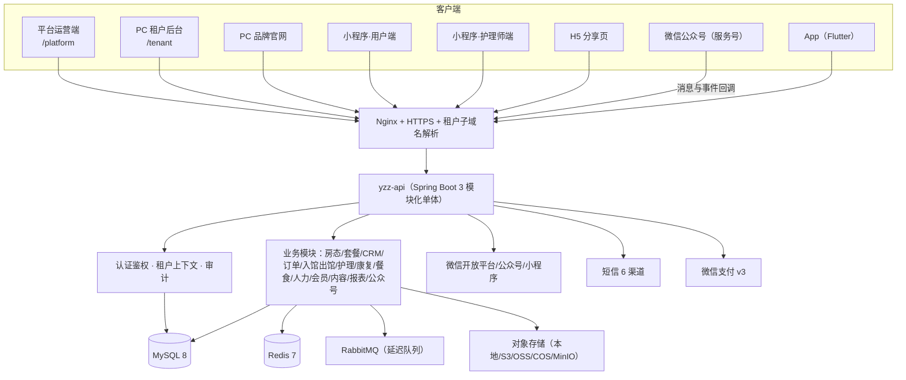
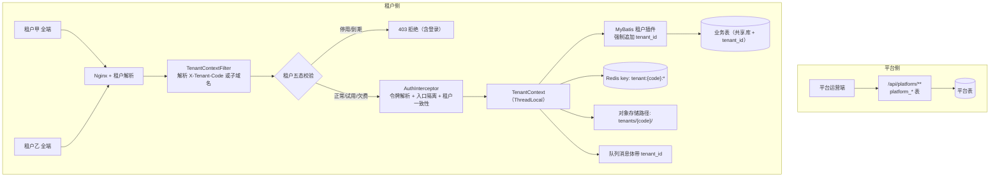
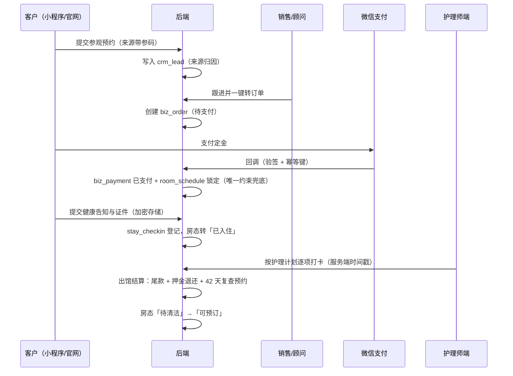
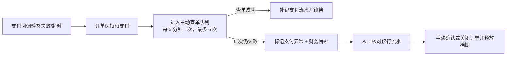
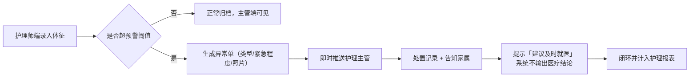

# 架构说明与核心数据流（T17）

> 对应 PRD 第二章。本文只保留落地所需的图与链路说明，技术选型对比与风险清单以 PRD 2.5/2.6 为准。

## 1. 一后端多前端壳



## 2. 多租户两条请求链路



**落地要点（与代码一一对应）**

| 环节 | 实现位置 |
|---|---|
| 租户解析（请求头 → 子域名） | `common/web/TenantContextFilter` |
| 五态拦截（停用/到期 403，欠费限写） | `TenantContextFilter` + `TenantLifecycleInterceptor` |
| 令牌签发（写入 tenant_id） | `system/service/TenantAuthService`、`platform/service/PlatformAuthService` |
| 入口物理隔离（平台端 ↔ 租户端） | `common/web/AuthInterceptor`（40305） |
| 篡改租户标识 403 + 安全审计 | `AuthInterceptor` + `JdbcAuditRecorder#recordSecurity`（40300） |
| DAO 强制租户条件 | `common/web/MybatisPlusConfig`（TenantLineInnerInterceptor） |
| 平台表跳过租户条件 | 表前缀 `platform_` 自动忽略 |

## 3. 核心数据流

### 3.1 正常链路：预约 → 定金 → 入住 → 结算



### 3.2 异常链路一：支付回调失败或丢失



### 3.3 异常链路二：护理体征超阈值



## 4. 模块依赖方向

```
yzz-api（启动 + 对外 REST）
  ├── yzz-platform（平台运营端：租户/套餐/账单/审计）
  │      └── yzz-tenant（租户域：平台表实体、状态机、初始化模板）
  ├── yzz-system（租户账号、登录、审计落库）
  │      └── yzz-tenant
  ├── yzz-common（统一返回/异常/租户上下文/幂等限流/审计/存储）
  └── yzz-room / product / crm / order / stay / care / rehab / meal / staff / member / content / report / mp
         └── yzz-common
```

禁止反向依赖：`common` 不依赖任何业务模块；`tenant` 只依赖 `common`；业务模块之间通过服务接口或领域事件交互，不直接引用对方 Mapper。
